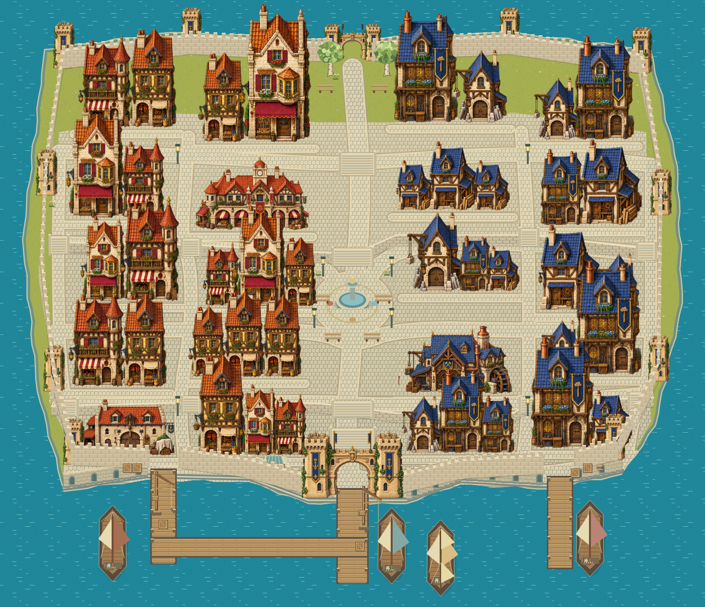

# Le Pays des Slimes

Cette carte est la référence de composition du pays. Les anciens terrains de développement servent de prototypes mécaniques ; leur taille et leur disposition ne limitent pas les nouvelles régions jouables.

## Origine retenue

Fatigué de voir les siens réduits à des monstres que les aventuriers attaquent, le Roi Slime s’exile pour construire un pays libre. Il se divise en quatre souverains chargés de façonner le territoire par l’Eau, la Terre, l’Air et le Feu. Le Comptoir de l’Exil est le lieu d’accueil qu’il fonde pour les aventuriers.

Une guerre éclate entre ses héritiers et divise le pays en quatre régions. Les slimes biéléments sont d’anciens guerriers ayant fusionné et évolué sur les champs de bataille. Les quatre souverains ont eux aussi été transformés : Gorgelimon Eau/Terre, Pyroclaste Terre/Feu, Nimbulimon Air/Eau et Siroccolimon Feu/Air.

Au centre dort le Roi originel, petit slime rond et doré. L’utilisation de la Clé du Roi, fabriquée à partir des quatre fragments détenus par les souverains, le réveillera. Son histoire ne se réduit pas à un volcan ou une source primordiale.

## Organisation du territoire

| Position | Région | Sous-zones et lieux |
| --- | --- | --- |
| Nord-ouest | Marais Éponge · Eau | Roselières, jardins des fleurs éponges, canaux brisés, cascade de l’Exil ; Crevasse engloutie de Gorgelimon en sous-sol. |
| Nord-est | Hauts d’Ambre · Terre | Carrière des Remparts, terrasses ambrées, col du Serment ; Cœur du volcan de Pyroclaste sur le front Terre/Feu. |
| Sud-est | Landes de Braise · Feu | Sources fumantes, plaines de cendre, forges abandonnées ; Fournaise des Vents Rouges de Siroccolimon. |
| Sud-ouest | Crêtes des Alizés · Air | Prairies suspendues, moulins du Premier Souffle, ponts des Alizés ; Œil des Tempêtes de Nimbulimon. |
| Centre | Sanctuaire du Roi endormi | Quatre routes anciennes convergent vers le petit Roi doré. |
| Littoral sud | Comptoir de l’Exil | Port d’arrivée, petite ville pour les aventuriers, services et mémoire du Premier Accueil. |

Les canaux, fortifications, routes et ateliers témoignent d’abord de la construction commune, puis de la guerre. Les donjons biéléments occupent les anciens fronts. Les futurs raccords doivent respecter ces relations géographiques.

## Première zone jouable : le Comptoir

Carte extérieure de 1 440 × 1 240 pixels monde, avec caméra à l’échelle des personnages. 43 bâtiments : façades mitoyennes, halle marchande, forge, entrepôt, capitainerie, auberge et services pour les aventuriers. Le port reste au sud du pays, avec la place du Refuge et la route du sanctuaire dans son axe central.

- **Sud :** trois pontons, liaison entre quais, quatre navires, grues de chargement, porte du Refuge et quais de pierre à arcades.
- **Centre :** place du Refuge, fontaine du renouveau, mosaïque aux quatre couleurs et commerces.
- **Ouest :** quartier des marchands, halle marchande, enchanteur, échoppe et animalerie.
- **Est :** quartier des artisans, forge, atelier de Tessa, scierie et capitainerie.
- **Nord :** jardins, îlots résidentiels et Maison du Premier Accueil.

Les rues sont sinueuses et bordées de façades mitoyennes de deux à trois étages. Vingt rangées partagent des trottoirs raccordés au réseau ; les anciennes pelouses du centre sont devenues des cours pavées. Les murs mitoyens sont fermés à la circulation, tout en gardant les portes accessibles. Une palette commune de pierre, enduit clair, bois et ardoises et tuiles de plusieurs teintes assure la cohésion. Les pavés utilisent un motif périodique unique en coordonnées monde ; les intersections partagent le même revêtement. Les arbres sont placés sur terre ferme et hors des accès. Les collisions utilisent les pieds des bâtiments, avec transparence des façades devant le joueur.

Seize promeneurs suivent les rues avec pauses et changements d’orientation. Douze habitants fixes incluent deux slimes pacifiques. Fontaine, enseignes, fumées, mouettes et reflets sont animés. Le plan du Comptoir et la carte du pays sont accessibles dans Monde → Comptoir.

La traversée depuis le Jardin des essais est gratuite : Monde → Comptoir → Embarquer, ou passage près du point `(310,365)` avec F. Retour au bout du ponton central `(720,1160)`. Le départ et la progression du tutoriel restent inchangés. Les quatre grandes régions seront construites et raccordées ensuite ; les anciennes zones de test conservent leurs accès.

Les services de forge, animalerie, bricolage, scierie et fontaine réutilisent leurs règles existantes. Maëla et Oriel vendent uniquement de l’équipement de voyage sans panoplie ; les noyaux gardent leur rôle dans l’obtention des ensembles élémentaires. Silo rachète les ressources normales et rares non chromatiques. L’auberge soigne la troupe contre 5 or. La position dans le Comptoir se sauvegarde sans changer la version ni invalider les anciennes sauvegardes.

Les anciens points de sauvegarde devenus invalides après la réduction de la ville reviennent au port, sans modifier le sac, les équipements ou la progression.

La référence portuaire guide désormais la direction artistique : tuiles chaudes à l’ouest, ardoises bleues à l’est, calcaire clair, arcades, escaliers, bannières royales et structures de chargement. Deux atlas transparents originaux fournissent dix assets réutilisables (six façades et quatre monuments), chargés à l’entrée dans la zone puis mis en cache. Le terrain et les collisions restent indépendants des images. Les versions Canvas servent de repli pendant le chargement.

### Aperçu du Comptoir intégré

### Remparts et relief

Les remparts suivent les bords du littoral et se raccordent aux quais. Dix tours, la porte du Refuge au sud et une porte au nord structurent l’enceinte. Les courtines et les tours bloquent le passage, tandis que les portes et les accès aux trois pontons restent praticables.

Le port, la terrasse intermédiaire et la ville haute forment trois paliers. Les deux fronts de terrasse suivent des contours irréguliers et se franchissent par dix escaliers, en plus des deux volées préexistantes. Les faces de soutènement sont infranchissables hors des escaliers ; les alliés utilisent la même navigation. Les différences de niveau sont de 18 puis 20 pixels, soit 38 pixels entre le port et la ville haute.

Les vingt fronts bâtis ont désormais des retraits, des largeurs de lots et des alignements propres. Les rues sont retracées entre eux. Les habitants se tiennent sur un espace d’approche libre devant leurs commerces et les promeneurs démarrent uniquement sur un point de rue praticable.
